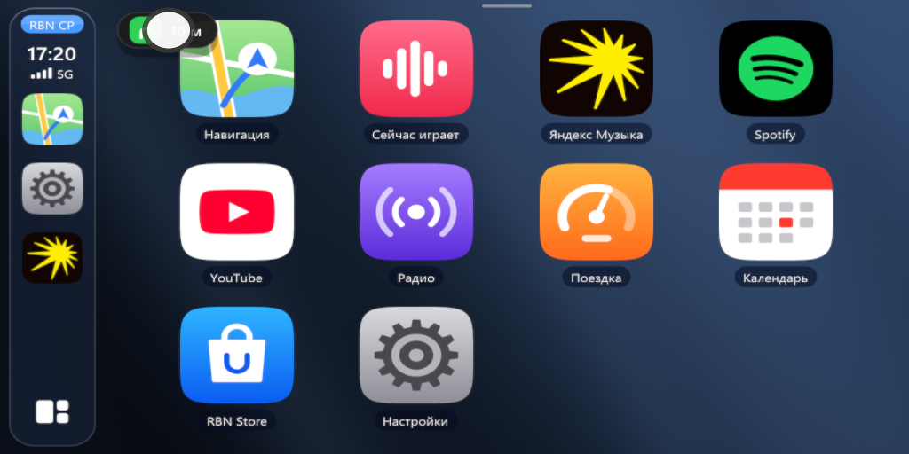
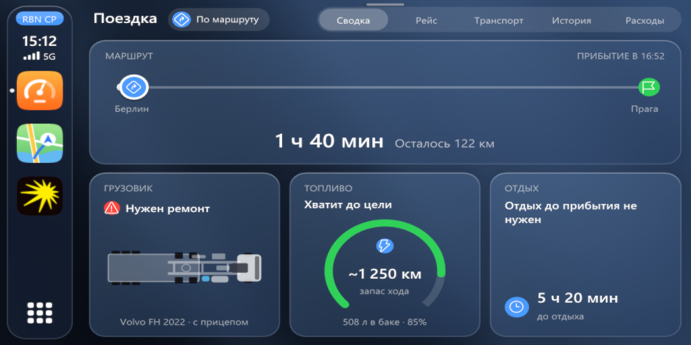
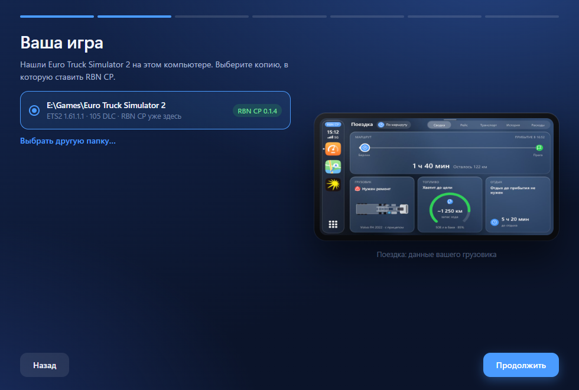
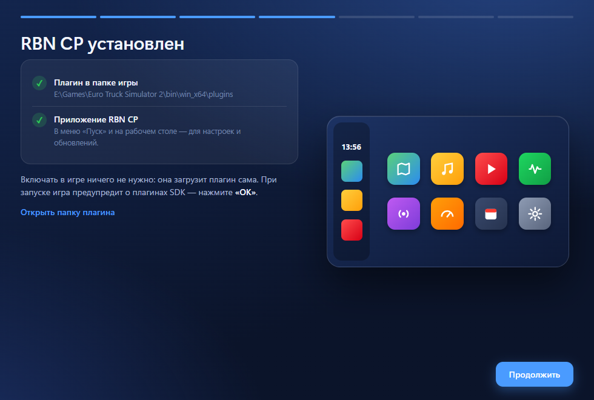
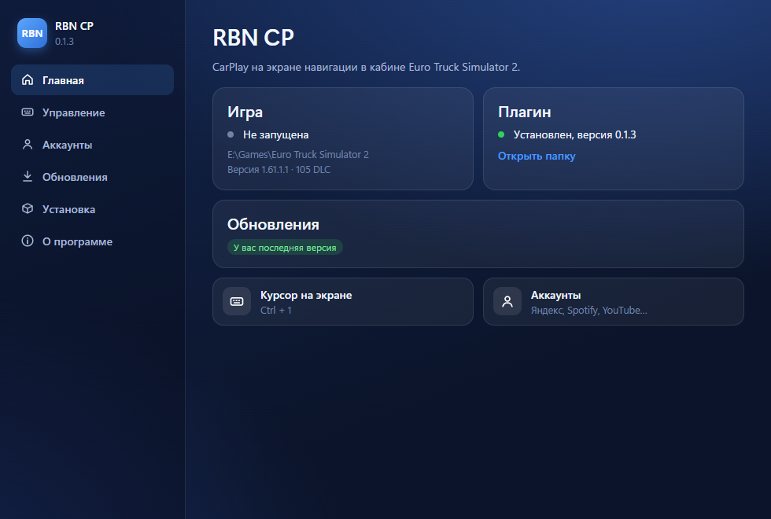

# RBN CP — CarPlay в кабине ETS2

[](../../releases/latest)
[](../../releases)


Плагин для Euro Truck Simulator 2 и American Truck Simulator: экран навигации в кабине превращается в CarPlay — карта с подсказками поворотов, музыка и видео, радио, приборы поездки и вид назад при включении задней передачи. Работает вместе с модами карт и с модовыми машинами.

<p align="center">
  
  
</p>

## ✨ Что умеет

- **Музыка и видео:** Яндекс Музыка, Spotify, YouTube, Apple Music, VK Музыка, SoundCloud, Rutube, VK Видео, Kick, Twitch и радио.
- **Моя музыка:** свои файлы из папки `Документы\RBN CP\Моя музыка` (MP3, M4A, AAC, FLAC, OGG, OPUS, WAV).
- **Свои сайты:** до шести любых сайтов как приложения.
- **Звук:** эквалайзер на 10 полос и режим «как из динамиков кабины».
- **Настройки для каждой машины:** свои в каждой, можно загрузить с другой машины.
- **Языки:** русский, английский, немецкий, польский, турецкий, испанский, французский.

## 🚚 Какие машины подходят

RBN CP сам находит экран в кабине, отдельно настраивать машину не нужно. Сначала он выбирает дисплей с картой, затем боковой, затем самый большой. Подходят и обычные, и модовые машины, в том числе с изогнутыми экранами и с картой на приборке.

В 414 кабинах из игры и модов выбор экрана проверен по их моделям. Экраны-аксессуары (телефон, планшет, навигатор на стекле) пока проверены только на тестовом стенде.

У некоторых машин настоящего экрана нет, поэтому показать CarPlay негде: например, у штатных Mercedes Actros 2009, Renault Magnum и Renault Premium. На таких машинах нужен аксессуар с экраном.

## ⬇️ Установка

1. Скачай **[RBN-CP-Setup.exe](../../releases/latest/download/RBN-CP-Setup.exe)** со страницы последнего релиза.
2. Запусти его. Установщик сам:
   - найдёт игру — в библиотеках Steam, среди установленных программ или по запущенной игре; если копий несколько, предложит выбрать;
   - покажет версию игры и число DLC, проверит, что версия поддерживается;
   - положит плагин в `bin\win_x64\plugins` (если папка защищена, один раз спросит права администратора);
   - предложит сочетание клавиш для курсора на экране (по умолчанию `Ctrl + 1`);
   - даст войти в музыкальные сервисы — это можно пропустить и сделать позже.
3. Запусти игру и нажми **OK** в окне о SDK-плагинах.

Если игра запущена во время установки, файлы всё равно заменятся — новая версия заработает при следующем запуске игры.

<p align="center">
  
  
</p>

> **Windows может предупредить «Система Windows защитила ваш компьютер».** Установщик пока не подписан сертификатом, поэтому SmartScreen его не знает. Нажми **Подробнее → Выполнить в любом случае**.

## 🖥 Приложение RBN CP

После установки в меню «Пуск» (и, если хочешь, на рабочем столе) появляется приложение **RBN CP**. В нём:

- **Главная** — найдена ли игра, запущена ли она, какая версия плагина стоит;
- **Управление** — сменить сочетание клавиш курсора;
- **Аккаунты** — войти в Яндекс Музыку, Spotify, YouTube и другие сервисы;
- **Обновления** — проверить и поставить новую версию;
- **Установка** — переустановить, выбрать другую копию игры или удалить плагин.

<p align="center"></p>

## 🔄 Обновления

Плагин сам раз в полдня смотрит, не вышла ли новая версия, и сообщает об этом уведомлением прямо на экране в кабине. Нажми на уведомление — откроется приложение RBN CP, где новая версия ставится одной кнопкой. Без твоего согласия ничего не скачивается.

## 🗑 Удаление

В приложении RBN CP: **Установка → Удалить**. Или через Windows: **Параметры → Приложения → RBN CP → Удалить**. Можно оставить настройки и входы в сервисы на случай, если поставишь плагин снова.

## Ручная установка (без установщика)

1. Закрой игру.
2. Скачай `RBN-CP-vX.Y.Z.zip` со страницы [Releases](../../releases/latest) и распакуй его в `bin\win_x64\` папки игры, чтобы получилось:
   ```
   bin\win_x64\plugins\carplay.dll
   bin\win_x64\plugins\carplay_login.exe
   bin\win_x64\plugins\rbncp\carplay_audio.dll
   ```
3. Запусти игру и нажми **OK** в окне о SDK-плагинах.

## Требования

- Windows 10/11 x64
- ETS2 на DirectX 11; проверено на версии 1.61
- American Truck Simulator на DirectX 11; поддержка новая, в самой игре ещё не проверена
- Microsoft Edge WebView2 Runtime — в Windows 11 уже есть, в Windows 10 установщик предложит его поставить

## Конфиденциальность

- Логин и пароль от музыкальных сервисов вводятся только на странице самого сервиса в отдельном окне. RBN CP их не видит и никуда не отправляет.
- Плагин обращается к GitHub только чтобы узнать номер последней версии.
- Кнопка «Создать отчёт о сбое» кладёт архив с логами на рабочий стол. Сам он никуда не отправляется.

---

© 2026 reborn. Все права защищены.

RBN CP — закрытая разработка. Копировать, изменять, разбирать и распространять его файлы, а также использовать их в своих модах без разрешения автора нельзя. Подробно — в [LICENSE](LICENSE). Скачивайте RBN CP только здесь: изменённый `carplay.dll` или запущенный не из папки `plugins` игры не запустится.
